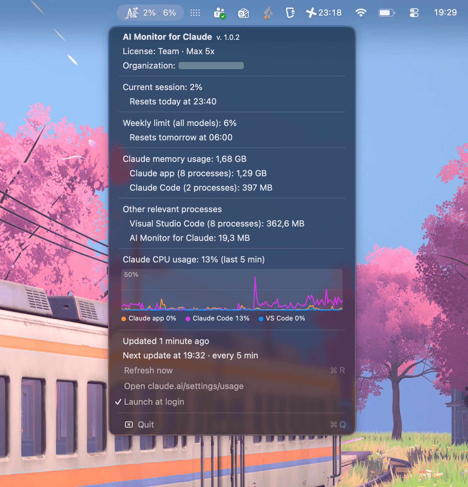
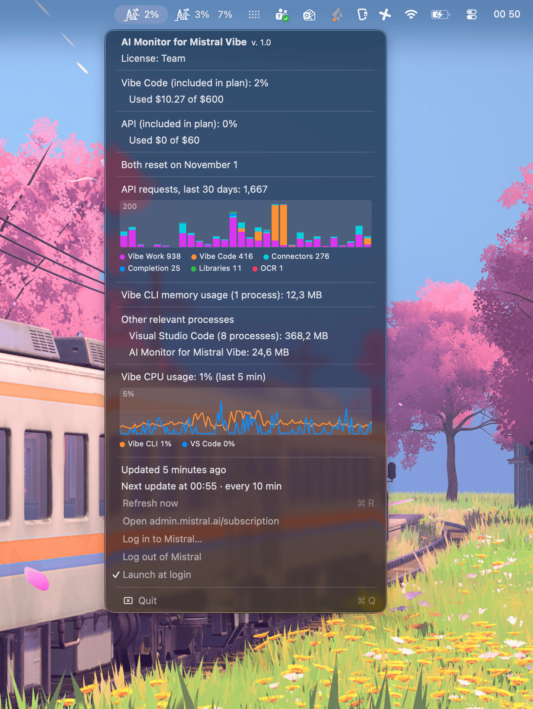

# AI Monitor

This repo contains various small menu bar utilities for monitoring your AI usage. Currently supporting the following AI vendors:

- Claude
- Mistral

Currently there are separate utilities for each vendor, so make sure you install the utility for your AI vendor.

## AI Monitor for Claude

A small macOS menu bar app that shows how much of your Claude usage limits you have used.

<p align="center">
  
</p>

The first number is the **current session** (the 5-hour window) and the second is the **weekly limit (all models)**, the same figures as `/usage` in Claude Code and claude.ai/settings/usage. A number turns **yellow at 50%** and **red at 75%**.

> **Unofficial.** This project is not made by, affiliated with or endorsed by Anthropic. It relies on undocumented endpoints that may change or stop working at any time.

## Features

Click the icon to open the menu:

- **App name and version**
- **New version available** – shown when a newer release is out on GitHub, with a link to it. The app checks once a day and also shows an alert once for each new version
- **License** – your plan, e.g. `Team · Max 5x`
- **Organization** – the name of your Claude organization
- **Current session** and **Weekly limit (all models)**, with the time each one resets
- **Claude memory usage** – total memory used by the Claude desktop app (including its `Claude Helper` processes) and by Claude Code CLI sessions, measured the same way as the *Memory* column in Activity Monitor
- **Other relevant processes** – memory used by Visual Studio Code (including its `Code Helper` processes) and by AI Monitor for Claude itself
- **Claude CPU usage** – a graph of the last 5 minutes for the Claude desktop app, Claude Code and Visual Studio Code, with the current value of each. 100% is one full CPU core, as in Activity Monitor. It is sampled every 2 seconds and keeps updating while the menu is open
- **Status line** – when the figures were last updated, or what went wrong
- **Refresh now** (⌘R), **Open claude.ai/settings/usage**, **Launch at login** and **Quit** (⌘Q)

The menu is in Norwegian if Norwegian is the first preferred language in macOS, and in English otherwise.

## Requirements

- macOS 13 (Ventura) or later
- [Claude Code](https://claude.com/claude-code) installed and logged in with a Claude account (Pro, Max, Team or Enterprise). The app reuses Claude Code's login, so there is no separate sign-in or API key.
- Xcode Command Line Tools, since the app is built from source (`xcode-select --install`)

## Install with Homebrew

```sh
brew install gauteweb/tap/aimonitor
open "$(brew --prefix aimonitor)/AI Monitor for Claude.app"
```

Homebrew downloads the source code from this repository and builds the app on your Mac. To start it automatically, choose **Launch at login** in the menu.

To upgrade:

```sh
brew upgrade aimonitor
pkill -x AIMonitorForClaude; open "$(brew --prefix aimonitor)/AI Monitor for Claude.app"
```

### Limitations of the Homebrew install

The app is not signed with an Apple Developer ID or notarized by Apple. A downloaded app like that is blocked by Gatekeeper, so instead of shipping a ready-made app, the Homebrew formula builds it from source on your own Mac. Apps you build yourself are not blocked. This has some drawbacks:

- **Xcode Command Line Tools are required**, and installing or upgrading compiles the app, which takes a little longer than a normal download.
- **The app is not placed in Applications.** It lives in Homebrew's folder (`$(brew --prefix aimonitor)`), so it may not show up in Launchpad or Spotlight. Start it with the `open` command above.
- **Launch at login must be turned on again after `brew upgrade`.** Each version is installed in a new folder, and the login item points to the old one. Turn **Launch at login** off and on again in the menu after upgrading.
- **Upgrading does not restart the app.** The old version keeps running until you quit it and open the new one.
- **`brew uninstall` does not remove settings or the login item.** See [Uninstall](#uninstall).

A signed and notarized version distributed as a Homebrew cask, which installs into Applications like a normal app, may come later.

## Build from source

```sh
git clone https://github.com/Gauteweb/aimonitor.git
cd aimonitor
./build.sh
```

The script compiles `Sources/Claude/` and `Sources/Shared/`, creates `AI Monitor for Claude.app`, signs it ad hoc, installs it in `~/Applications`, stops any running copy and starts the new one. With `./build.sh --build-only` it only builds the app in `build/`.

To start it automatically, choose **Launch at login** in the menu.

## How it works

| What | Source |
|---|---|
| Usage percentages | `GET https://api.anthropic.com/api/oauth/usage` (`five_hour` and `seven_day`) |
| Organization name | `GET https://api.anthropic.com/api/oauth/profile` |
| License | `subscriptionType` and `rateLimitTier` in Claude Code's keychain item |
| Memory and CPU | `proc_pid_rusage` (physical footprint, and user + system CPU time) for processes in `Claude.app`, Claude Code processes and processes in `Visual Studio Code.app` |

The access token is read from the `Claude Code-credentials` item in the login keychain via `/usr/bin/security`. It is only sent to `api.anthropic.com`, and never stored by this app.

### Refresh and rate limits

The usage endpoint is rate limited and shared with Claude Code itself, so the app is deliberately cautious:

- Usage is refreshed every **5 minutes**, and never more often. This minimum applies to every request: the timer, opening the menu, **Refresh now**, waking the Mac and restarting the app.
- On **HTTP 429** the interval is doubled: 10, 20, 40 and at most 60 minutes. It keeps showing the last figures with a ⚠︎ in the meantime.
- The raised interval stays in place, and is halved again after 6 successful refreshes in a row, but never below 5 minutes.
- The menu shows when the next refresh will happen and the current interval.
- The last response, the interval and the time of the next allowed request are saved, so restarts and upgrades show figures immediately and do not cause extra requests.
- The organization name is fetched at most once a day.

## Troubleshooting

| Message | Meaning |
|---|---|
| `waiting` in the menu bar | No figures yet and the last attempt failed. See the status line in the menu. |
| ⚠︎ after the figures | The figures are from an earlier successful refresh. The latest attempt failed. |
| Claude Code login not found | Run `claude` and log in. |
| Token expired – open Claude Code to renew it | The app does not renew the login itself, since that could log you out of Claude Code. Using Claude Code renews it. |
| Too many requests (HTTP 429) | Rate limited. The app retries automatically at the time shown. |

## Uninstall

If **Launch at login** is enabled, turn it off in the menu first. Then:

```sh
pkill -x AIMonitorForClaude

# If installed with Homebrew
brew uninstall aimonitor

# If built from source
rm -rf ~/Applications/"AI Monitor for Claude.app"

# Remove settings and cached figures
defaults delete net.gauteweb.aimonitor
```

## AI Monitor for Mistral Vibe

The repository also contains **AI Monitor for Mistral Vibe**, the same kind of menu bar app for [Mistral Vibe](https://mistral.ai/products/vibe).

<p align="center">
  
</p>

Install it with Homebrew:

```sh
brew install gauteweb/tap/aimonitor-mistral-vibe
open "$(brew --prefix aimonitor-mistral-vibe)/AI Monitor for Mistral Vibe.app"
```

Or build it from source with `./build.sh vibe`. The [limitations of the Homebrew install](#limitations-of-the-homebrew-install) apply to it as well. To upgrade:

```sh
brew upgrade aimonitor-mistral-vibe
pkill -x AIMonitorForMistralVibe; open "$(brew --prefix aimonitor-mistral-vibe)/AI Monitor for Mistral Vibe.app"
```

The menu bar shows how much of the **included Vibe Code usage** this month you have used, with the same colours as the Claude app. The menu shows:

- **License** – your Mistral plan, e.g. `Team`
- **New version available** – a link to a newer release on GitHub, as in the Claude app
- **Vibe Code (included in plan)** and **API (included in plan)** – percentage and amount, e.g. `$10.07 of $600`, and the day both reset (the first day of each month)
- **API requests, last 30 days** – a bar chart per day, split by usage type (Vibe Work, Vibe Code, Connectors, Completion, …) with the total for each, like the chart at admin.mistral.ai/organization/usage
- **Vibe CLI memory usage**, **other relevant processes** and a **CPU graph** for Vibe CLI and Visual Studio Code, as in the Claude app
- **Refresh now**, **Open admin.mistral.ai/subscription**, **Log in to Mistral…**, **Log out of Mistral**, **Launch at login** and **Quit**

> **Unofficial.** Not made by, affiliated with or endorsed by Mistral AI.

### How it works

Mistral has no API for the included allowances. Vibe's own API key cannot read them either. The app therefore reads them from the subscription page at [admin.mistral.ai/subscription](https://admin.mistral.ai/subscription), which is only shown to organization admins:

- Choose **Log in to Mistral…** and log in once in the window that opens. The window closes by itself when the figures have been read.
- The login is kept in the app's own web view storage (not in your browser). **Log out of Mistral** removes it.
- The page is loaded in a hidden web view every **10 minutes**, and the amounts are read from the text on the page. If Mistral changes the page, this may stop working.
- The API requests come from `/api/local-trpc/usage.timeseries`, the internal endpoint the usage page uses. It is called from inside the logged-in page, so it uses the same login. If only this part fails, the menu keeps showing the last graph.
- If the figures can't be read (not logged in, not an admin, or the page has changed), the menu bar shows only the icon and the menu shows the reason. Plan, memory and CPU still work. The plan then comes from Vibe's own cache, `~/.vibe/whoami_cache.json`.
- Vibe CLI is recognised by its process title `Vibe CLI` (it runs as `python3.13`).

To uninstall it, turn off **Launch at login** in the menu, then:

```sh
pkill -x AIMonitorForMistralVibe
brew uninstall aimonitor-mistral-vibe                     # if installed with Homebrew
rm -rf ~/Applications/"AI Monitor for Mistral Vibe.app"   # if built from source
defaults delete net.gauteweb.aimonitor.vibe
rm -rf ~/Library/WebKit/net.gauteweb.aimonitor.vibe   # the Mistral login
```

## Project structure

```
Sources/Claude/          AI Monitor for Claude (AppKit, no dependencies)
Sources/Vibe/            AI Monitor for Mistral Vibe (AppKit and WebKit)
Sources/Shared/          Code used by both: processes, CPU graph, menu, icon, language
build.sh                 Builds, signs, installs and launches an app: ./build.sh [claude|vibe] [--build-only]
ai-monitor-icon-512.png  App icon (build.sh turns it into AppIcon.icns)
LICENSE                  MIT license
.github/workflows/       Release workflow
```

## Releasing a new version

1. Set `VERSION` in `build.sh`, for example `VERSION="1.0"`, and commit.
2. Tag and push:
   ```sh
   git tag v1.0
   git push origin main v1.0
   ```

The [Release workflow](.github/workflows/release.yml) then checks that the tag matches `VERSION`, builds the app, creates a GitHub release, and updates `url` and `sha256` in the formula in [Gauteweb/homebrew-tap](https://github.com/Gauteweb/homebrew-tap). The formula is installed and tested before the update is pushed. A release for an existing tag can also be started by hand under *Actions → Release → Run workflow*.

The workflow needs the repository secret `HOMEBREW_TAP_DEPLOY_KEY`: the private half of a deploy key with write access to `Gauteweb/homebrew-tap`.

AI Monitor for Mistral Vibe is released the same way, with `VIBE_VERSION` in `build.sh` and tags of the form `mistral-vibe-v1.0`. The workflow then updates `Formula/aimonitor-mistral-vibe.rb` instead, and leaves AI Monitor for Claude as the repository's latest release.

## License

[MIT](LICENSE) © 2026 Gaute Holmin

Claude is a trademark of Anthropic. Mistral and Mistral Vibe are trademarks of Mistral AI. This project is an independent, unofficial tool.
